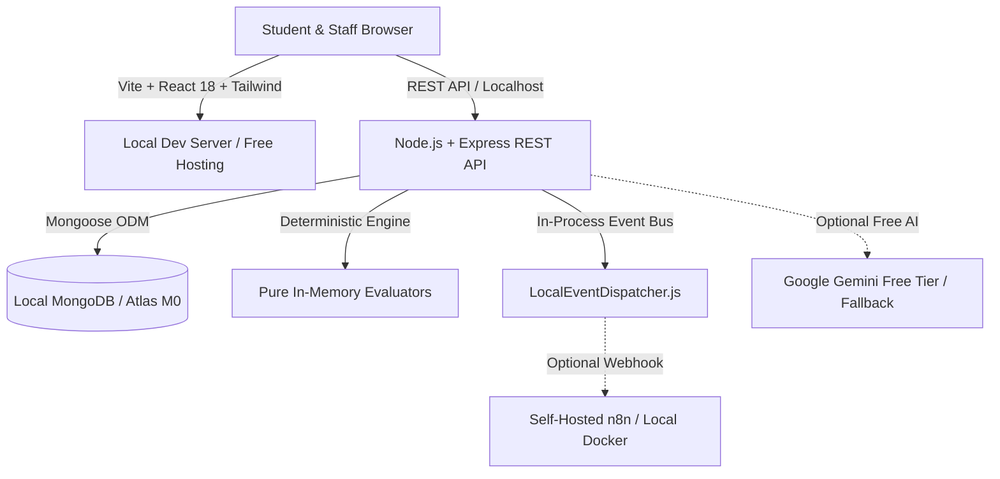

# ADMINATOR — SMART ADMISSIONS. ZERO CHAOS.
> AI-assisted Multilingual Diploma Admission Enquiry & Counselling Platform

---

## 1. Executive Overview

**ADMINATOR** is an AI-assisted, multilingual Diploma Admission Enquiry and Counselling Platform engineered specifically for polytechnic and diploma engineering institutions across regional India (with focus on Odisha).

Designed with a **React-based WhatsApp Simulator** as its primary student interface and a **centralized administrative CRM**, ADMINATOR bridges the communication gap between aspiring students/guardians and polytechnic institutions while enforcing an **absolute ₹0 additional-cost mandate**.

### Core Platform Capabilities
- **Dual-Engine Multilingual Counselling**: Instant guidance in **English, Odia, and Hindi** powered by a default **Deterministic Decision Tree Engine** (requiring zero external AI APIs and zero internet) with an optional Gemini Free-Tier adapter.
- **Deterministic Eligibility Evaluation**: 100% mathematical consistency evaluating 1st Year (Post-10th) and Lateral Entry (Post-12th Science / ITI) criteria. **AI models are strictly forbidden from calculating eligibility or deciding admissions.**
- **WhatsApp-Style Student Simulator**: High-fidelity in-browser messaging simulator with contact headers, double checkmarks (`✓✓`), typing bubbles, and quick-reply action chips. **Real commercial WhatsApp Business API integration is explicitly prohibited in this release.**
- **Offline-First Data Architecture**: Runs 100% locally on Node.js and local MongoDB (`mongodb://localhost:27017/adminator`), or on genuinely free cloud tiers (MongoDB Atlas M0, Vercel Free).
- **In-Process Zero-Cost Event Dispatcher**: Automated internal CRM notifications and audit logging powered by native Node.js `EventEmitter` (`LocalEventDispatcher.js`), eliminating any dependency on paid automation services.

---

## 2. Zero-Cost Guarantee and Limitations

### 2.1 Dependency Audit & Cost Matrix
| Component | Technology | Free Guarantee | Zero-Cost / Offline Fallback |
| :--- | :--- | :---: | :--- |
| **Frontend UI** | React 18 + Vite + Tailwind | **100% Free** | Runs locally via `npm run dev` (`localhost:5173`). |
| **Backend REST API**| Node.js LTS + Express | **100% Free** | Runs locally via `npm start` (`localhost:5000`). |
| **Database** | MongoDB Community Edition | **100% Free** | Local `mongod` (`localhost:27017`). Zero cloud accounts needed. |
| **Cloud Database** | MongoDB Atlas M0 Cluster | **Conditionally Free** | 512MB free tier cap. Local MongoDB is the primary fallback. |
| **Conversational AI**| Built-in Deterministic Engine | **100% Free** | **Default primary engine (0 API tokens, 0 external calls).** |
| **Optional AI Model**| Google Gemini Free Tier | **Conditionally Free** | 15 RPM cap. Seamlessly falls back to Deterministic Engine on error. |
| **Event Automation** | Node.js `EventEmitter` | **100% Free** | `LocalEventDispatcher.js` runs in-memory; 0 external servers. |
| **External n8n** | n8n Cloud | **NOT Free (14d trial)** | **Prohibited from critical path.** Replaced by local `EventEmitter`. |
| **Student Chat** | React WhatsApp Simulator | **100% Free** | In-browser simulator. Prohibits paid Meta WhatsApp APIs. |

### 2.2 Features Postponed Due to Potential Charges
1. **Real WhatsApp Outbound Messages**: Replaced by the React WhatsApp Simulator.
2. **Paid Cellular SMS OTPs**: Replaced by dual-key verification (`trackingId` + `mobileNumber`).
3. **Paid Cloud Secret Managers**: Replaced by local `.env` configuration.
4. **Third-Party Payment Gateways**: Simulated fee estimate receipts only.

---

## 3. Important Demo & Data Integrity Notice

> [!IMPORTANT]
> **DEMO DATA DISCLAIMER**:
> ADMINATOR currently runs on **100% fictional demonstration datasets**.
> - All colleges (KIPT, UPP, MIET), student profiles, cut-offs, and fee structures are simulated.
> - No official admission decisions, guaranteed seats, or government counseling portal affiliations (e.g., SAMS Odisha / DTE&T) are claimed or executed.
> - Every demo record is explicitly tagged with `isDemo: true`.

---

## 4. Documentation Map

The complete engineering blueprint and zero-cost specifications are located in the [`docs/`](file:///d:/ADMINATOR/docs) directory:

| Document | Primary Focus |
| :--- | :--- |
| **[PRD.md](file:///d:/ADMINATOR/docs/PRD.md)** | Product Requirements Document: Vision, Zero-Cost Mandate, WhatsApp Simulator, Functional (FR1–FR22) & NFRs. |
| **[TDD.md](file:///d:/ADMINATOR/docs/TDD.md)** | Technical Design Document: Offline-First Architecture, Dual-Engine Counselling, In-Process Event Dispatcher. |
| **[DATABASE_SCHEMA.md](file:///d:/ADMINATOR/docs/DATABASE_SCHEMA.md)** | MongoDB Collections, Local Indexing, Strict Multi-Tenancy, Zero Cloud Extensions. |
| **[API_SPECIFICATION.md](file:///d:/ADMINATOR/docs/API_SPECIFICATION.md)** | REST API Specification: Endpoints, DTOs, Idempotency, Local Deterministic Messaging. |
| **[AI_BUILD_RULES.md](file:///d:/ADMINATOR/docs/AI_BUILD_RULES.md)** | Engineering Rules: Zero External AI Dependency, Banned Commercial Messaging SDKs. |
| **[UI_UX_SPECIFICATION.md](file:///d:/ADMINATOR/docs/UI_UX_SPECIFICATION.md)** | Design System: WhatsApp Simulator UI, Embedded Offline Fonts (Odia/Hindi), WCAG 2.1 AA. |
| **[N8N_WORKFLOW_DESIGN.md](file:///d:/ADMINATOR/docs/N8N_WORKFLOW_DESIGN.md)** | Event Orchestration: Built-in In-Process EventEmitter (`LocalEventDispatcher.js`) vs Optional n8n. |
| **[SECURITY_AND_PRIVACY.md](file:///d:/ADMINATOR/docs/SECURITY_AND_PRIVACY.md)** | Security Architecture: Zero-Cost Secret Handling, Dual-Key Auth, DPDP Act 2023 Consent. |
| **[TESTING_STRATEGY.md](file:///d:/ADMINATOR/docs/TESTING_STRATEGY.md)** | QA Strategy: Zero-Cost Vitest/Playwright, Offline Test Suites, Network Disconnect Resiliency. |
| **[IMPLEMENTATION_PLAN.md](file:///d:/ADMINATOR/docs/IMPLEMENTATION_PLAN.md)** | 8-Phase Local-First Roadmap: Critical Path with 100% Zero-Cost Milestones. |
| **[DEMO_DATA_SPECIFICATION.md](file:///d:/ADMINATOR/docs/DEMO_DATA_SPECIFICATION.md)** | Fictional Dataset: 3 Odisha Polytechnic Colleges, 6 Engineering Branches, Sample Rules & Fees. |
| **[RISK_REGISTER.md](file:///d:/ADMINATOR/docs/RISK_REGISTER.md)** | Comprehensive Risk Analysis: Cost Risks, n8n Trial Expiry, Network Outage Mitigations. |
| **[DECISIONS_AND_OPEN_QUESTIONS.md](file:///d:/ADMINATOR/docs/DECISIONS_AND_OPEN_QUESTIONS.md)** | Architecture Decision Records (ADR 001–009) and Zero-Cost Sign-Offs. |

---

## 5. Technology Stack Summary

---

## 6. Zero-Cost Fallback Resiliency Checklist

ADMINATOR remains completely demonstrable and functional even when:
- ❌ **External AI is disabled or rate-limited**: Deterministic Counselling Engine handles student questions using keyword decision trees in English, Odia, and Hindi.
- ❌ **Internet is disconnected**: The entire platform runs locally on `localhost:5000` and `localhost:5173` with local MongoDB.
- ❌ **n8n is not installed or offline**: `LocalEventDispatcher.js` captures all events in memory without errors.
- ❌ **External messaging services are absent**: In-browser WhatsApp Simulator provides authentic conversational ergonomics with zero external calls.
